# TP1 DevOps : de l'application au déploiement

Mini-projet EMSI (Prof. Bakkali Yedri Othman) : **Code → Test → Git → Docker → CI**.

Une petite API REST Flask, testée avec pytest, versionnée avec Git, conteneurisée avec Docker et vérifiée automatiquement par GitHub Actions à chaque push.

## Structure du dépôt

```
devops-tp1/
├── .github/workflows/ci.yml   # CI : installe les dépendances et lance pytest
├── app/main.py                # API Flask
├── tests/test_main.py         # 2 tests pytest
├── screenshots/               # preuves (tests, Docker, Git, CI)
├── Dockerfile
├── .dockerignore
├── .gitignore
└── requirements.txt           # versions figées
```

## Installation (Windows)

```
git clone https://github.com/anakin-skyguy/devops-tp1.git
cd devops-tp1
python -m venv .venv
.venv\Scripts\activate
pip install -r requirements.txt
```

## 1. API Flask

```
python app/main.py
```

| Route | Réponse |
|---|---|
| `/` | `{"application": "DevOps TP1", "status": "running"}` |
| `/hello/<name>` | `{"message": "Bonjour <name> !"}` |

## 2. Tests

```
python -m pytest -v
```

2 tests : `test_home` (statut 200 et `status == running`) et `test_hello` (message `Bonjour Amine !`). On utilise `python -m pytest` pour que le dossier `app` soit trouvé à l'import.

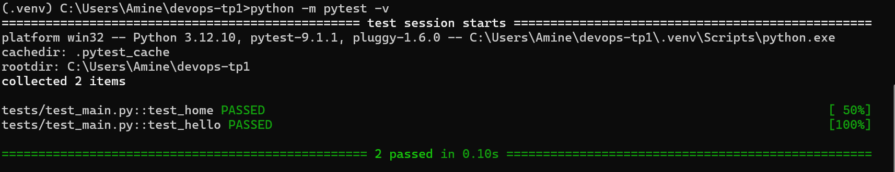

## 3. Git

Deux commits de départ : `ddd0267` (Initialisation DevOps) et `4da3573` (Dockerfile et CI). Le `.gitignore` exclut `.venv/`, `__pycache__/` et `.pytest_cache/`.

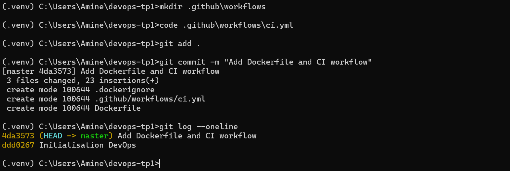

## 4. Docker

```
docker build -t devops-tp1:1.0 .
docker run -d --name devops-tp1 -p 5000:5000 devops-tp1:1.0
docker ps
```

L'application tourne dans le conteneur et répond sur http://127.0.0.1:5000. L'API écoute sur `0.0.0.0` pour être joignable depuis l'extérieur du conteneur. Le `.dockerignore` évite de copier l'environnement virtuel dans l'image.

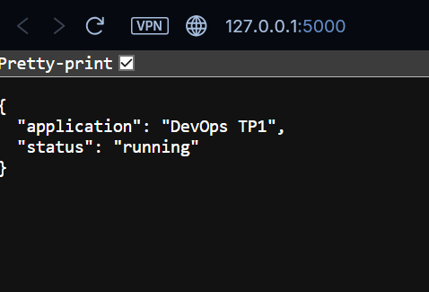
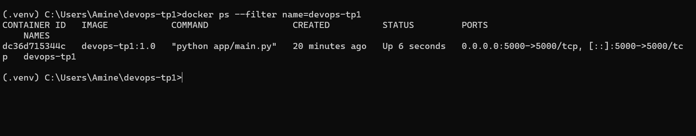

## 5. CI GitHub Actions

Le workflow `.github/workflows/ci.yml` se déclenche à chaque `push` et `pull_request` sur une machine Linux propre : récupération du code, installation de Python 3.12, installation des dépendances, puis `python -m pytest -v`.

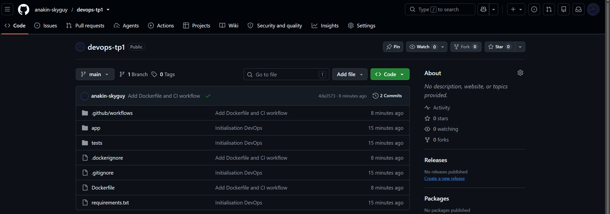
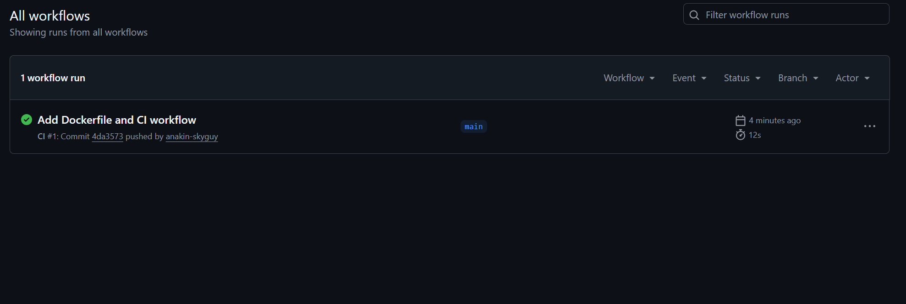

### Démonstration d'un échec

Pour montrer ce qui arrive quand un test échoue, j'ai volontairement cassé `test_home` (`"running"` remplacé par `"stopped"`).

- En local : `1 failed, 1 passed`.
- Sur GitHub : le run `CI #2` (commit `c3e6ef8`) passe au **rouge**. Les étapes d'installation réussissent, seule l'étape pytest échoue avec `AssertionError: assert 'running' == 'stopped'` et `Process completed with exit code 1`.
- Après correction (commit `09d2e30`), le run suivant repasse au **vert**.

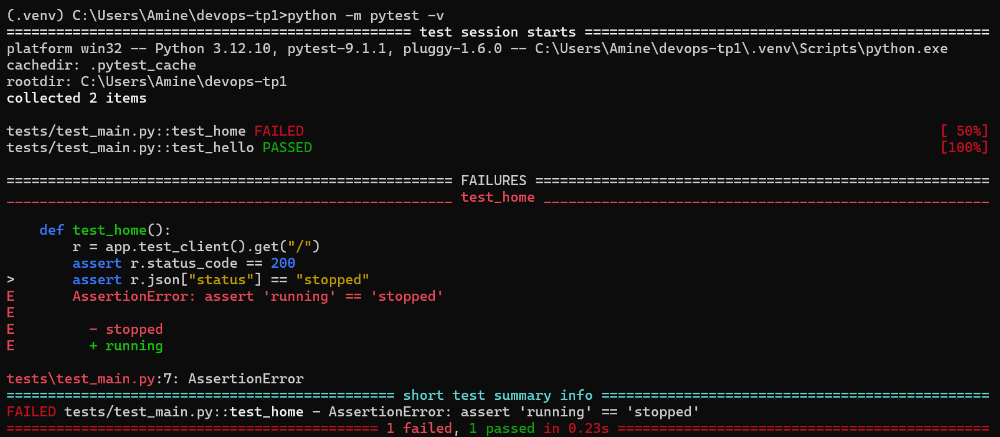
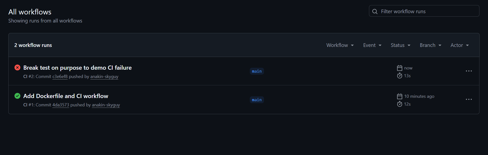
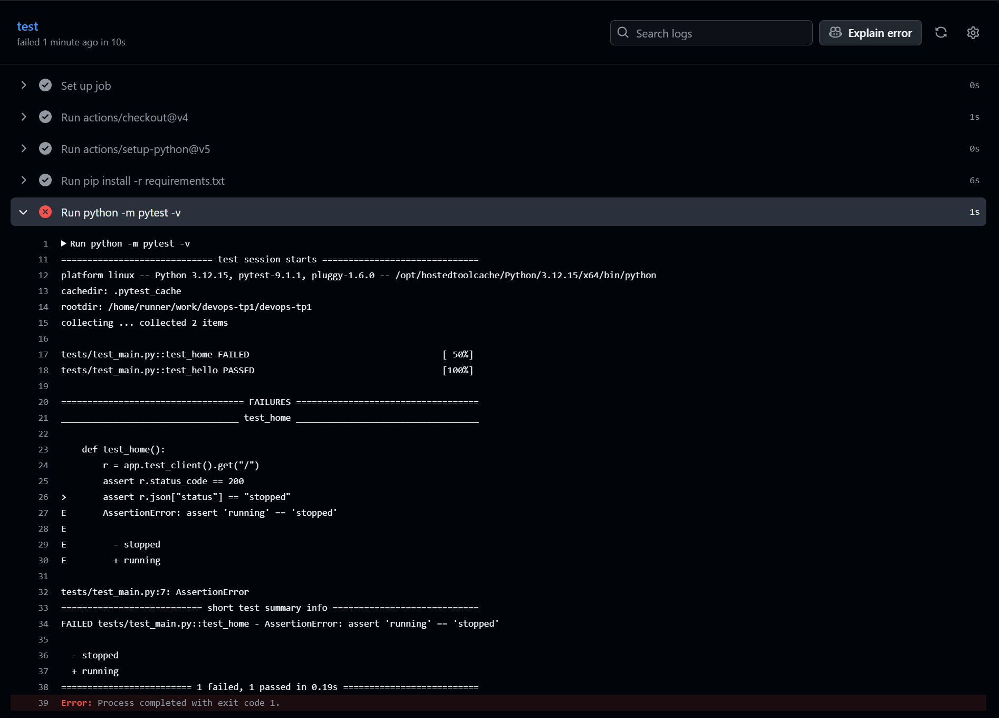
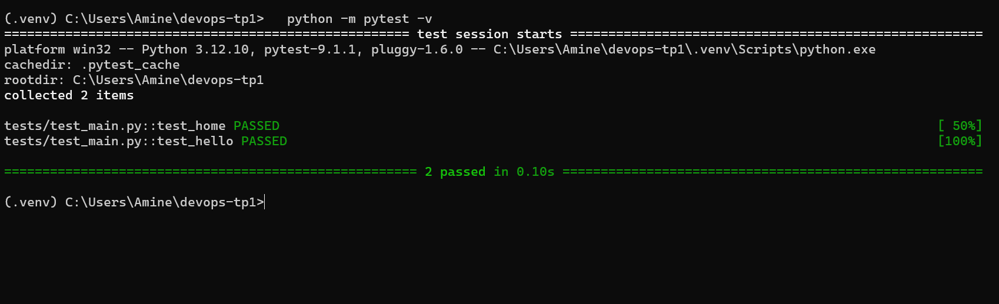
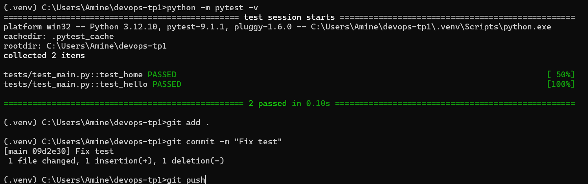

## Réponses aux questions du TP

**Pourquoi tester avant le build ?**
Pour détecter une erreur le plus tôt possible. Construire et publier une image qui contient du code cassé fait perdre du temps et risque de livrer un bug. Un test échoue en quelques secondes, alors qu'un problème découvert en production coûte beaucoup plus cher.

**Quel est le rôle de Docker ?**
Docker empaquette l'application avec Python et les bibliothèques aux versions exactes dans une image. Elle s'exécute de la même façon sur n'importe quelle machine, ce qui évite le problème « ça marche chez moi ».

**Que se passe-t-il si un test échoue ?**
Le pipeline s'arrête et le run devient rouge (code de sortie 1). Les étapes suivantes ne sont pas exécutées et le code défectueux ne peut pas être livré. Le run `CI #2` en est la preuve : l'erreur est visible dans les logs et identique à celle obtenue en local.

**Quelle différence entre CI et déploiement ?**
La CI (intégration continue) vérifie automatiquement chaque modification : installation, tests, éventuellement build. Le déploiement consiste à mettre une version validée à disposition des utilisateurs (serveur, cloud). Dans ce TP, la CI exécute les tests ; l'image Docker est construite et lancée en local, et il n'y a pas de déploiement automatique.

## Pistes d'amélioration

- Construire l'image Docker dans la CI (`docker build`) pour vérifier le Dockerfile à chaque push.
- Publier l'image sur un registre (Docker Hub, GHCR) après des tests réussis : c'est le début du déploiement continu.
- Ajouter un test pour un cas d'erreur, par exemple une route inexistante qui doit renvoyer 404.